<picture><source media="(prefers-color-scheme: dark)" srcset="assets/floor-dark.svg"></picture>

Independent technical consultant and full-stack developer, based in the Philippines. I help founders and growing teams turn business problems into working software. Clients in the Netherlands, the US and the Philippines. I work European hours.

Former licensed physical therapist, self-taught into software.

<a href="https://dmdfajardo.pro"> dmdfajardo.pro</a> / <a href="https://www.linkedin.com/in/dave-fajardo-686374188/"> LinkedIn</a> / <a href="mailto:dmd.fajardo2000@gmail.com"> Email</a>

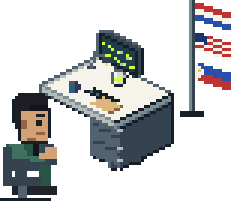 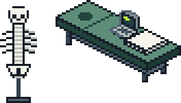

## Projects

| Project | Type | What it does |
|-|-|-|
| [Material Transition](https://materialtransition.com/) | Supplier intelligence platform | Helps sourcing teams find suppliers, compare materials and trace supply chains. Search 260K+ suppliers, 200K+ products and 94K+ certified materials in plain language. |
| [Logistics & Fulfillment ERP](https://shipbeefulfillment.com/) | 3PL fulfillment control tower | Connects Shopify orders with suppliers and carriers across 200+ countries. Teams manage dispatch, tracking, inventory, quality checks and finances in one workspace. |
| [Stencil Lab](https://www.stencillab.ai/) | AI SaaS, multi-layer stencil generator | Turns images into layered spray-paint stencils and matches colours across 12+ paint brands. Built for spray-paint artist Tom "Welly" Wells. |
| [Agrippa](https://agrippa-tau.vercel.app/) | AI agent, 6 tools | An AI assistant that searches the web, draws charts and diagrams, generates images and looks up weather and Wikipedia, all in one conversation. |
| [Deadnet](https://dead-internet-one.vercel.app/) | Dead Internet Theory simulator | Simulates social-media debates with AI personas from different countries. |
| [ClimaTales AR](https://climatales.dmdfajardo.pro/) | Educational AR storybook | Teaches climate science through an augmented-reality storybook. |
| [Element Hanap](https://element-hanap.vercel.app/) | Chemistry AR scavenger hunt | Learners scan their surroundings to collect 65 elements and 8 compounds. |
| [Cell Quest](https://cell-quest.vercel.app/) | Biology learning game | A checkpoint-based quiz game with timed questions, hints and difficulty levels. |
| [CTU Equipment Tracking](https://ctu-tracking-system.vercel.app/) | Cebu Technological University | QR-based equipment checkout and audit records. |
| [CNU Landslide Simulator](https://landslide-simulator.vercel.app/) | Cebu Normal University | Helps a research team explore government hazard data. |
| [Silikon.ai](https://www.silikon.ai/) | Brand and landing design | A brand website for AI hardware, using scroll-driven storytelling. |

## Stack

<b>Languages</b>

 

<a href="https://www.typescriptlang.org" title="TypeScript"><picture><source media="(prefers-color-scheme: dark)" srcset="assets/stack/typescript-dark.svg">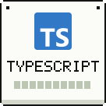</picture></a> <a href="https://developer.mozilla.org/docs/Web/JavaScript" title="JavaScript"><picture><source media="(prefers-color-scheme: dark)" srcset="assets/stack/javascript-dark.svg">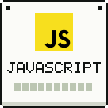</picture></a> <a href="https://www.python.org" title="Python"><picture><source media="(prefers-color-scheme: dark)" srcset="assets/stack/python-dark.svg">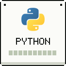</picture></a> <a href="https://www.rust-lang.org" title="Rust"><picture><source media="(prefers-color-scheme: dark)" srcset="assets/stack/rust-dark.svg">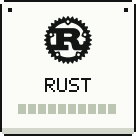</picture></a> <a href="https://www.postgresql.org/docs/current/sql.html" title="SQL"><picture><source media="(prefers-color-scheme: dark)" srcset="assets/stack/sql-dark.svg">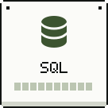</picture></a>

<b>Frontend</b>

 

<a href="https://react.dev" title="React"><picture><source media="(prefers-color-scheme: dark)" srcset="assets/stack/react-dark.svg">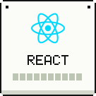</picture></a> <a href="https://nextjs.org" title="Next.js"><picture><source media="(prefers-color-scheme: dark)" srcset="assets/stack/next-js-dark.svg">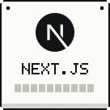</picture></a> <a href="https://svelte.dev" title="Svelte"><picture><source media="(prefers-color-scheme: dark)" srcset="assets/stack/svelte-dark.svg">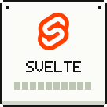</picture></a> <a href="https://astro.build" title="Astro"><picture><source media="(prefers-color-scheme: dark)" srcset="assets/stack/astro-dark.svg">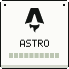</picture></a> <a href="https://tailwindcss.com" title="Tailwind CSS"><picture><source media="(prefers-color-scheme: dark)" srcset="assets/stack/tailwind-dark.svg">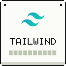</picture></a> <a href="https://ui.shadcn.com" title="shadcn/ui"><picture><source media="(prefers-color-scheme: dark)" srcset="assets/stack/shadcn-ui-dark.svg">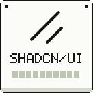</picture></a>

<b>Backend and data</b>

 

<a href="https://nodejs.org" title="Node.js"><picture><source media="(prefers-color-scheme: dark)" srcset="assets/stack/node-js-dark.svg">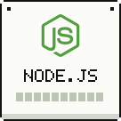</picture></a> <a href="https://supabase.com" title="Supabase"><picture><source media="(prefers-color-scheme: dark)" srcset="assets/stack/supabase-dark.svg"></picture></a> <a href="https://www.postgresql.org" title="PostgreSQL"><picture><source media="(prefers-color-scheme: dark)" srcset="assets/stack/postgresql-dark.svg">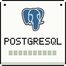</picture></a> <a href="https://www.mongodb.com" title="MongoDB"><picture><source media="(prefers-color-scheme: dark)" srcset="assets/stack/mongodb-dark.svg">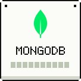</picture></a> <a href="https://duckdb.org" title="DuckDB"><picture><source media="(prefers-color-scheme: dark)" srcset="assets/stack/duckdb-dark.svg">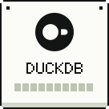</picture></a>

<b>AI</b>

 

<a href="https://www.anthropic.com/claude" title="Claude"><picture><source media="(prefers-color-scheme: dark)" srcset="assets/stack/claude-dark.svg">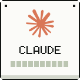</picture></a> <a href="https://openai.com" title="OpenAI"><picture><source media="(prefers-color-scheme: dark)" srcset="assets/stack/openai-dark.svg">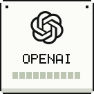</picture></a> <a href="https://openrouter.ai" title="OpenRouter"><picture><source media="(prefers-color-scheme: dark)" srcset="assets/stack/openrouter-dark.svg">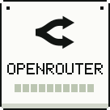</picture></a> <a href="https://ai-sdk.dev" title="Vercel AI SDK"><picture><source media="(prefers-color-scheme: dark)" srcset="assets/stack/ai-sdk-dark.svg">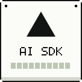</picture></a> <a href="https://www.langchain.com" title="LangChain"><picture><source media="(prefers-color-scheme: dark)" srcset="assets/stack/langchain-dark.svg">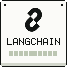</picture></a> <a href="https://www.pinecone.io" title="Pinecone"><picture><source media="(prefers-color-scheme: dark)" srcset="assets/stack/pinecone-dark.svg">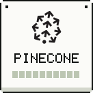</picture></a>

<b>Automation</b>

 

<a href="https://n8n.io" title="n8n"><picture><source media="(prefers-color-scheme: dark)" srcset="assets/stack/n8n-dark.svg">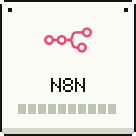</picture></a> <a href="https://www.make.com" title="Make"><picture><source media="(prefers-color-scheme: dark)" srcset="assets/stack/make-dark.svg">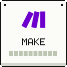</picture></a> <a href="https://github.com/features/actions" title="GitHub Actions"><picture><source media="(prefers-color-scheme: dark)" srcset="assets/stack/actions-dark.svg">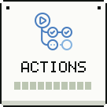</picture></a> <a href="https://www.shopify.com" title="Shopify"><picture><source media="(prefers-color-scheme: dark)" srcset="assets/stack/shopify-dark.svg">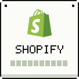</picture></a>

<b>Infrastructure</b>

 

<a href="https://vercel.com" title="Vercel"><picture><source media="(prefers-color-scheme: dark)" srcset="assets/stack/vercel-dark.svg">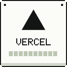</picture></a> <a href="https://www.cloudflare.com" title="Cloudflare"><picture><source media="(prefers-color-scheme: dark)" srcset="assets/stack/cloudflare-dark.svg">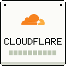</picture></a> <a href="https://aws.amazon.com" title="AWS"><picture><source media="(prefers-color-scheme: dark)" srcset="assets/stack/aws-dark.svg">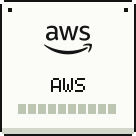</picture></a> <a href="https://www.docker.com" title="Docker"><picture><source media="(prefers-color-scheme: dark)" srcset="assets/stack/docker-dark.svg">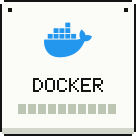</picture></a> <a href="https://git-scm.com" title="Git"><picture><source media="(prefers-color-scheme: dark)" srcset="assets/stack/git-dark.svg">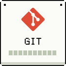</picture></a>

## The last 12 months

<picture><source media="(prefers-color-scheme: dark)" srcset="assets/chart-line-dark.svg"></picture>

<picture><source media="(prefers-color-scheme: dark)" srcset="assets/chart-donut-dark.svg"></picture> <picture><source media="(prefers-color-scheme: dark)" srcset="assets/chart-rings-dark.svg"></picture> <picture><source media="(prefers-color-scheme: dark)" srcset="assets/chart-radial-dark.svg"></picture>

<picture><source media="(prefers-color-scheme: dark)" srcset="assets/chart-waffle-dark.svg"></picture>

<a href="https://cal.com/dmd-fajardo/project-consultation"><picture><source media="(prefers-color-scheme: dark)" srcset="assets/book-dark.svg"></picture></a>

